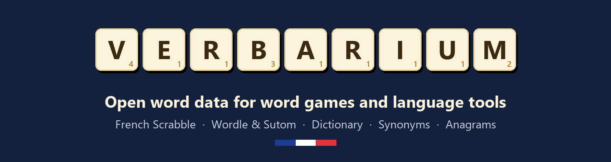

**Open word data for word games and language tools.** Clean, documented word lists you can drop into a project, built from the data behind a family of free word sites.

### Datasets

| Repository | What's inside |
|---|---|
| [french-word-games](https://github.com/verbarium/french-word-games) | French Wordle, Sutom and hangman word lists, best opening words, letter stats |

More are on the way, a clean French dictionary, synonyms and antonyms in six languages, and anagram families.

### Also On

- Kaggle, [French Wordle, Sutom And Hangman Word Lists](https://www.kaggle.com/datasets/cuivrax/french-word-games-starter-pack) and [French Word Frequency And Scrabble Validity](https://www.kaggle.com/datasets/cuivrax/french-word-frequency-scrabble-validity)
- Hugging Face, [French Wordle, Sutom And Hangman Word Lists](https://huggingface.co/datasets/verbarium/french-wordle-sutom-word-lists), [French Word Frequency And Scrabble Validity](https://huggingface.co/datasets/verbarium/french-word-frequency-scrabble-validity) and the free [Mots Valides Au Scrabble](https://huggingface.co/spaces/verbarium/french-scrabble-word-checker) word checker

### The Sites Behind The Data

- [Mot Valide](https://www.motvalide.fr/), French Scrabble word checker with definitions and anagrams
- [Synopedia](https://www.synopedia.com/), synonyms and antonyms in six languages
- [Anagrammio](https://www.anagrammio.com/), anagram solver in five languages

All datasets are shared under open licenses (mostly CC BY-SA 4.0). Credit the source site when you reuse them.
